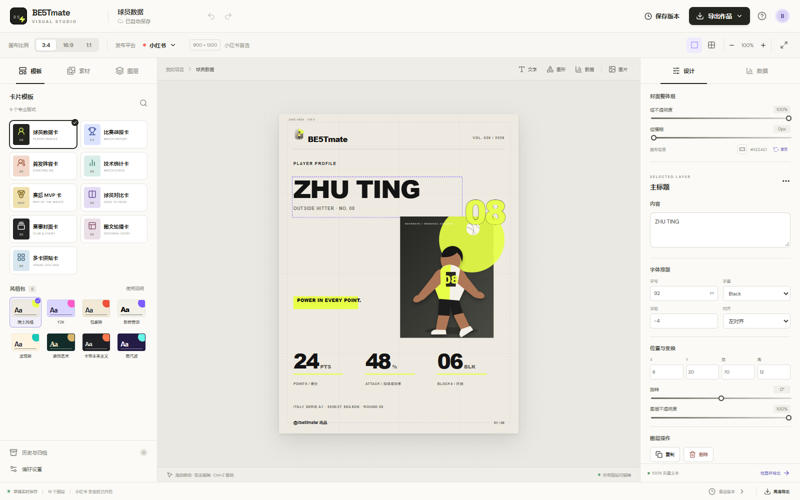

# BE5Tmate · Volleyball Visual Studio

> 专业排球比赛与球员数据卡片生成器 —— 一个纯前端、可编辑、可高清导出的体育视觉工作台。




BE5Tmate 把「上传素材 → 选比例与平台 → 选模板与风格 → 编辑图文数据 → 多卡融合 → 高清导出 → 版本归档」串成一条完整链路。所有文字、图形、数据模块都是**独立可编辑图层**，画布以 SVG 渲染，导出时再绘制到 Canvas，因此切换比例不会破版，2×/3× 导出依旧锐利。

---

## 功能特性

### 画布与平台

- **三种核心比例**：`3:4`、`16:9`、`1:1`，每种比例都有独立校准的字阶与图文位置，而非简单等比缩放
- **平台预设**：小红书、微信贴图、视频号、抖音号、微信公众号，各自带尺寸与安全区提示
- **视图辅助**：60%–140% 缩放、安全区开关、12 列网格叠加，一键适应窗口

### 模板与风格

- **9 类卡片模板**：球员数据卡、比赛战报卡、首发阵容卡、技术统计卡、赛后 MVP 卡、球员对比卡、赛事封面卡、图文轮播卡、多卡拼贴卡
- **8 套风格包**：瑞士国际主义、Y2K、包豪斯、新野兽派、孟菲斯、装饰艺术、卡带未来主义、蒸汽波
- 风格包统一定义配色、字体、几何形状、纹理与图表样式，切换后版式保持稳定

### 编辑能力

- **图层系统**：文字、数据、图片、几何装饰独立成层，支持选中、拖拽、缩放、锁定、隐藏、复制、上下移动与删除
- **无损编辑**：撤销 / 重做，导出前不栅格化，文字始终保留可编辑状态
- **图片处理**：多图上传、排序、圆形 / 圆角 / 矩形裁切、旋转、翻转、描边、亮度、对比度、饱和度、模糊与透明度
- **头像系统**：可替换账户头像，尺寸、位置、透明度、描边与阴影可调，默认不遮挡核心信息
- **组级控制**：「封面整体组」的透明度与模糊独立于单图层控制，画布背景色可单独设定
- **多卡融合**：网格、拼贴、叠层、统一背景四种融合方式，融合后仍能按组逐层编辑

### 数据可视化

- 大数字、环形图、条形图、雷达图、趋势线五种呈现方式，一键切换不破版
- 数值与单位分离（`24` + `PTS`），单位以较小字号跟随主数字
- 字段可增删、排序、重命名，数值可高亮

### 导出与归档

- **格式**：PNG、JPG、WebP、PDF，可多选一次导出多个文件，支持透明背景 PNG
- **倍率**：1× / 2× / 3×，按实际像素尺寸渲染，不做屏幕截图
- **高光交互**：实时显示导出像素尺寸（如 `900 × 1200 px`）与越界检查，导出后自动留存一个历史版本
- **历史与归档**：自动草稿、手动保存版本（最多 30 个）、缩略图、命名、标签、收藏、搜索、归档与一键恢复

### 响应式

- 桌面三栏工作台：左侧素材 / 模板 / 图层，中间画布，右侧属性与数据
- 390px 移动端：底部「属性」抽屉、浮动面板与精简状态栏

---

## 快速开始

需要 **Node.js 18+**（推荐 20 或更高）。

```bash
# 1. 安装依赖（推荐用锁文件还原完全一致的版本）
npm ci

# 2. 启动开发服务器
npm run dev
# 打开 http://localhost:5173

# 3. 生产构建
npm run build

# 4. 本地预览构建产物
npm run preview
```

> 若没有 `package-lock.json` 或想升级依赖，把 `npm ci` 换成 `npm install`。
> 构建产物使用绝对路径 `/assets/...`，请通过本地服务或部署访问，直接用 `file://` 双击 `dist/index.html` 会白屏。

---

## 目录结构

```
.
├── index.html              # 入口 HTML
├── package.json
├── package-lock.json       # 锁定依赖版本，务必保留
├── src
│   ├── main.jsx            # React 挂载
│   ├── App.jsx             # 工作台、图层渲染器、编辑交互、归档逻辑
│   ├── data.js             # 比例 / 平台 / 模板 / 风格包 / 原创运动员插画
│   ├── export.js           # SVG → Canvas 高清渲染，PNG / JPG / WebP / PDF 导出
│   └── styles.css          # 视觉系统与响应式布局
└── docs                    # README 配图
```

---

## 工作台怎么用

1. 左侧「素材」上传球员图、比赛图、背景图与头像，可多选并拖动排序
2. 顶部选比例与发布平台，画布自动切换到对应安全区
3. 左侧「模板」选卡片类型，底部「风格包」换整套视觉皮肤
4. 点选任意元素，在右侧「设计」面板改字号、字重、字距、位置、透明度；切到「数据」面板改数值、单位与图表类型
5. 需要拼版时用「多卡拼贴卡」，或对整组调整透明度与模糊做统一氛围
6. 右上「导出作品」选格式与倍率，`1×` 预览、`2×/3×` 交付
7. 「历史与归档」保存版本、命名、收藏或恢复任意节点

**快捷键**：`Ctrl/Cmd + Z` 撤销、`Ctrl/Cmd + Shift + Z` 重做、`Ctrl/Cmd + S` 保存当前版本、`Delete / Backspace` 删除所选图层（锁定图层不响应）。

---

## 数据存储

本项目**没有后端**，所有数据保存在浏览器本地：

| 键名 | 内容 |
| --- | --- |
| `be5tmate-draft` | 当前画布草稿（含图层、样式、上传图片的 base64） |
| `be5tmate-versions` | 手动保存的版本列表与缩略图 |

这意味着：

- 换浏览器、无痕模式或清空站点数据都会丢失草稿
- 存储上限通常为 5MB 左右，上传大图较多时可能写满，建议及时导出成图
- 换电脑迁移时，画布数据不会随代码一起带走，需要重新上传素材

---

## 技术实现

- **React 19 + Vite 8**，无 UI 框架依赖，样式为手写 CSS 变量系统
- **图标**：lucide-react
- **画布**：整个卡片是一棵 SVG 元素树，图层即 props，编辑即刻反映到 DOM
- **导出**：序列化 SVG → `Image` → `Canvas` → `toBlob`；PDF 由 jsPDF 承载
- **状态**：单一 `project` 对象 + 不可变更新，配合历史栈实现撤销重做
- **字体**：系统无衬线栈（Inter / Helvetica / PingFang SC / Noto Sans SC），不引入需授权字体

```bash
npm run build   # 产物在 dist/
```

### 部署

`dist/` 是纯静态站点，可直接放到任意静态托管（Vercel、Netlify、Cloudflare Pages、GitHub Pages、对象存储）。若部署在子路径（如 `https://user.github.io/repo/`），需要在 `vite.config.js` 中设置 `base: '/repo/'` 后重新构建。

---

## 设计说明

- 版式骨架取自瑞士国际主义网格与体育编辑设计：12 列网格、8pt 间距、强层级、大数字、精确对齐
- 配色为中性基底 + 高饱和强调色，强调色随风格包切换
- 卡片底部固定落款 `@//be5tmate/ 出品`
- **合规声明**：项目内所有运动员形象为原创矢量插画，模板仅借鉴网格、字阶、图片裁切与数据可视化的设计方法，**不含**任何俱乐部、赛事、品牌或媒体的商标、队徽、赞助商标识与版权版式。请勿将本工具用于未经授权的商业赛事素材。

---

## 许可证

本仓库暂未附带开源许可证。如需开源或商用，请先补充 `LICENSE` 文件（MIT / Apache-2.0 等）并确认所用字体与素材的授权范围。
